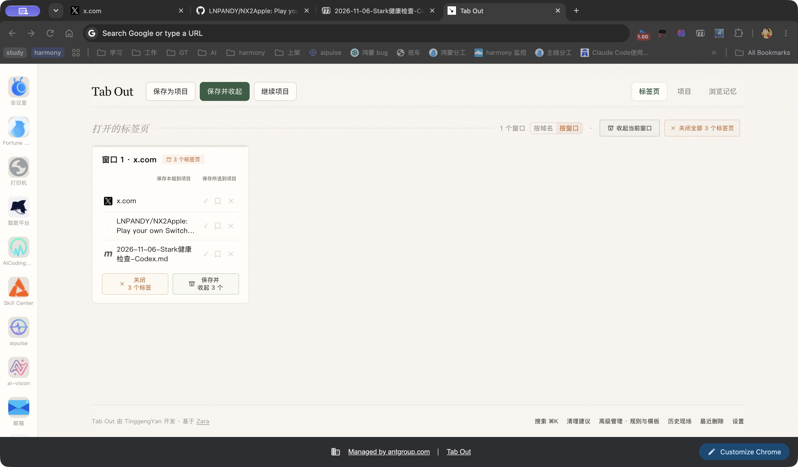
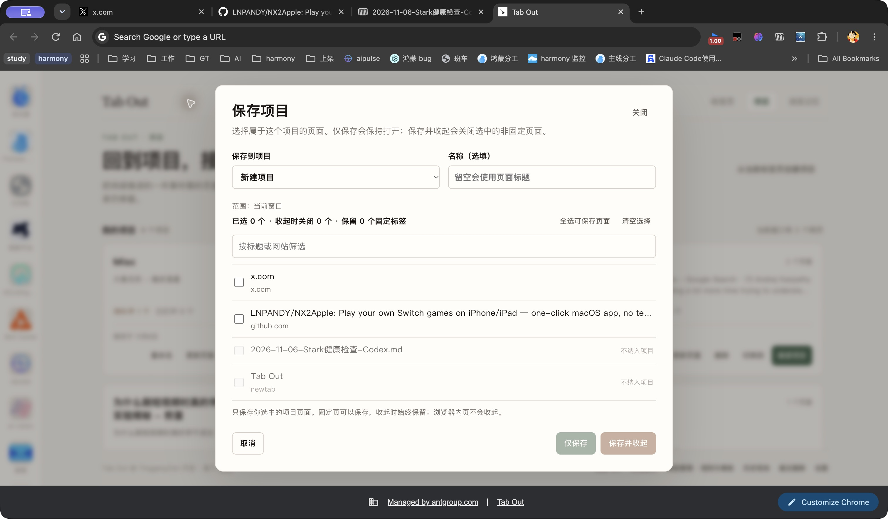
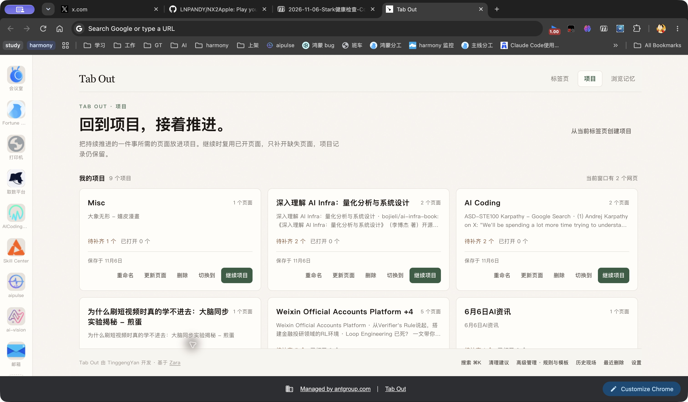
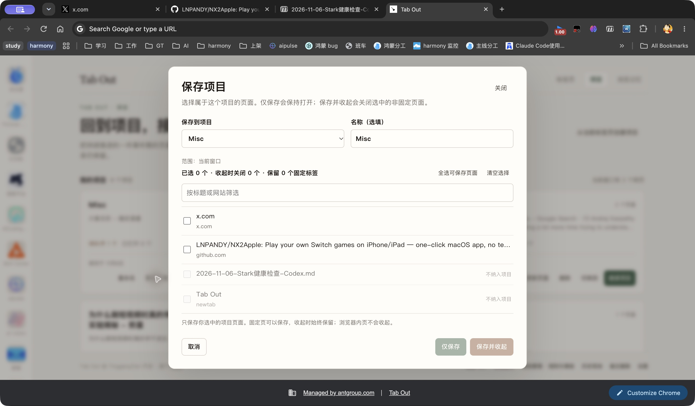

# Tab Out：标签页与项目的产品及交互审视

日期：2026-11-06。使用Product Design audit，直接查看当前Chrome中已安装的Tab Out。本轮只查看、打开预览并取消，未执行保存、收起、更新或切换，最后回到标签页。以下分别标记事实与建议；没有修改产品代码。

## 结论与定位建议

目前的主要问题是用户必须理解浏览器页面、保存分组、恢复与切换之间的关系，才能做一次简单的收纳。上一轮收敛重复文案和按钮颜色只改善局部，没有解决这些关系。

建议产品承诺：**放心收起暂时不用的网页，需要时找回并接着用。**

主流程是打开→选择→保存（可同时关闭）→找回→继续。项目用于长期归拢同一件事的页面，但不要求每次随手保存都先建立一个有意义的项目。浏览记忆承接“当时没有保存”的找回需求；本轮没有评估其搜索效果。

## 本轮实际走查

### 1. 标签页首页：职责混杂，需要优先调整

事实：顶部有保存为项目、保存并收起、继续项目；正文有收起当前窗口，卡片又有本组、所选、保存并收起。来源范围与执行结果被拆成多组按钮。卡片显示3个页面，后续保存预览中仅2个网页可选，另一页明确不纳入项目。

优点：可直接看当前页面；分组卡片集中展示来源；关闭和保存有不同文字。

风险：用户尚未选择页面，就要先理解“项目”；多个保存入口使选择起点不明确。建议选中页面后才出现统一操作栏，列出选择数量和范围。窗口/域名只是视图组织方式，不自动代表一个项目。批量关闭放进次级菜单。

### 2. 从标签页保存：预览安全，但任务不够单纯

事实：弹窗后方已经是项目页；弹窗包含目标项目、新建名称、选择列表和两种提交按钮。初始0项选中，不自动把混合窗口全部保存，这是值得保留的保护。

风险：新建、修改已有内容、选择范围、是否关页同时发生；“保存到项目”不能说明对已有项目是追加还是替换。建议用户先选页面，再选新建或已有分组；明确写“添加到已有项目”。替换操作单独进入变更预览。

### 3. 取消后回到项目列表：来源丢失，优先修复

事实：步骤2按取消，落在项目页，而非原来的标签页；焦点在项目导航。项目卡片同时显示重命名、更新页面、删除、切换到、继续项目，共5个动作。页面包含单篇文章和多页主题分组，“待补齐”用于尚未打开的页面。

优点：有保存日期、页面数和已开数量；保留既有保存内容，统一入口。

风险：取消改变所在视图；“待补齐”容易被理解为保存内容残缺；单篇文章被要求理解为持续推进的项目；“切换到”和“继续项目”的关闭影响不清楚。卡片仅摘要若干标题，缺少明显的查看完整内容入口。

建议：取消恢复来源视图、滚动和选择；项目名称可进入详情。主动作只保留“打开未打开的N页”，已有页面不重复开、其他页面不关闭。“切换”降至详情中的高级操作，说明要收起哪一组以及哪些页面会保留。状态改为“已保存N页·其中M页已打开”，正常关闭不作警示。

### 4. 更新项目：保存对象与当前页面容易混淆

事实：点击一个当前没有成员打开的项目的“更新页面”，打开与新建相同的“保存项目”弹窗，选中0项，显示当前窗口的网页，没有先展示该项目原有页面。取消能回到对应项目按钮。本轮未提交更新。

代码补充：project-service的saveInternal捕获所选标签，向saveSession传入已有workspaceId及新session；该入口不是明确的“只追加页面”流程。不得仅凭本轮截图声称实际发生了丢失。

建议：在详情里区分“添加打开的页面”与“用当前选择替换”，后者必须展示新增、保留、移除。编辑已保存页面应能查看全部内容，不必先把它们重新打开。

## 建议采用的产品关系

| 对象 | 对用户的含义 | 关键规则 |
| --- | --- | --- |
| 打开的标签页 | 浏览器现在开着的页面 | 关闭页面不删除保存记录 |
| 已保存 | 用户主动留下的页面分组；包含现有全部项目 | 保存不必关闭；打开不会消耗保存记录 |
| 浏览记忆 | 曾访问但未必主动保存的页面线索 | 与主动保存区分，按需检索 |

页面的“打开/关闭”与“是否已保存”相互独立；同一网址可用于多个分组。不能把“项目”等同于一个窗口，也不能凭某个网址匹配就自动认定用户正在操作哪个项目。

建议导航为“打开的标签页／已保存／浏览记忆”。这是让入口说明内容状态，保留项目名称、已有记录与分组能力，不删除项目功能，也不新增收纳箱、临时组等平行类型。代价是弱化首页的任务切换叙事；当前混合窗口使用方式更需要这种简单、可预测的规则。

## 建议动线（待设计和验证）

1. 当前页面按域名或窗口查看，跨卡片选择属于同一件事的页面。
2. 统一操作栏出现“保存所选N页”；明确范围，允许新建分组或添加到已有分组。保存默认不关闭，关闭所选是明确的附加选择。
3. 成功后留在来源视图，显示保存去向及“查看”；若选择关闭，显示实际关闭数量并可撤销。取消不改变来源。
4. 在已保存列表点名称查看完整页面，既可打开单页，也可补开未打开的页面；打开后保存内容仍保留。
5. 在详情添加/移除保存页面；替换保存内容或收起来源再切换需明确变更和关闭范围。

## 优先级与验收

- 第一批：取消回原处；明确两个视图职责；统一选择后操作；详情查看保存内容；区分添加与替换。
- 第二批：卡片保留一个主要动作，其他动作收进菜单；正常未打开状态使用中性文字；核对可保存数量与实际关闭数量。
- 后续：再决定是否把高级切换提升为核心，不在这次重构加入自动分类、自动项目归属或新AI功能。

用“混合窗口里保存一件事的3页→关闭→次日找回→补充1页”验收：不看说明能完成；能预判是否关闭其他页面、是否替换旧内容；取消始终回到来源；打开后记录仍在。需要真实试用反馈，不能用自动化测试通过代替易用性验证。

## 可访问性与证据边界

截图可见卡片图标和次级文字较淡，小图标含义依赖识别；需要测量对比度并检查键盘焦点。保存弹窗的不可选项目使用禁用状态和文字双重说明，这是优点。

本轮只有当前中文桌面状态，未做全键盘、屏幕阅读器、多语言、手机、完整保存恢复执行或性能测试，不声称可访问性合规。9条现有保存内容仅用于查看；不能据此判断所有用户的使用习惯。产品定位与新动线是建议，尚未实施或用户验证。
